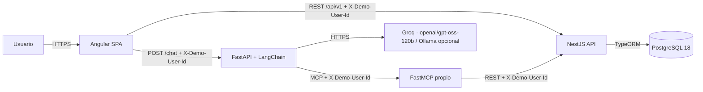

# Lost & Found

Monorepo del proyecto **Lost & Found**: una aplicación para registrar objetos perdidos y encontrados, buscar coincidencias y gestionar solicitudes de recuperación y devoluciones.

> **Estado de esta entrega:** CU1–CU10 implementados. CU8 incorpora devoluciones y `COMPLETED`; CU9 incorpora consulta, edición y cierre de publicaciones propias, sin eliminación. La gestión de solicitudes relacionadas quedó parcial. La identidad es de demostración (`X-Demo-User-Id`); JWT/RS256 no está implementado.

## Objetivo

Construir una aplicación full stack con reglas de negocio centralizadas en NestJS, una interfaz Angular y un asistente conversacional que utiliza herramientas MCP sin acceder directamente a PostgreSQL ni duplicar reglas del dominio.

## Casos de uso aprobados

1. Registrar una publicación de objeto perdido.
2. Registrar una publicación de objeto encontrado.
3. Buscar publicaciones.
4. Filtrar y ordenar resultados.
5. Ver el detalle de una publicación.
6. Sugerir coincidencias entre publicaciones perdidas y encontradas.
7. Solicitar la recuperación de un objeto encontrado.
8. Gestionar la devolución de un objeto.
9. Gestionar las publicaciones propias.
10. Usar el asistente conversacional.

### Estado por caso de uso

| # | Estado en esta entrega |
|---|---|
| 1–7 | Implementados y verificados |
| 8 | Implementado: devolución, `COMPLETED` y `RETURNED` |
| 9 | Implementado parcialmente: consulta, edición y cierre de publicaciones propias; sin eliminación |
| 10 | Implementado: asistente con preparación de acciones, vista previa, confirmación explícita y MCP de lectura/escritura |

## Stack

| Capa | Tecnología | Estado / versión |
|---|---|---|
| Frontend | Angular + TypeScript + SCSS | Angular 22.2.x, Vitest 5.x |
| Backend | NestJS + TypeScript + CommonJS | NestJS 12.3.2, TypeScript 6.0.3, Node 24.20.0 |
| Base de datos | PostgreSQL 18 nativo en Windows | Implementado; sin Docker |
| Persistencia | TypeORM con migraciones | TypeORM 0.3.31, `pg` 8.23.1 |
| Servicio de IA | Python + FastAPI + LangChain | Python 3.12.1, FastAPI 0.162.1, LangChain 1.4.8 |
| MCP | FastMCP + MCP + `langchain-mcp-adapters` | FastMCP 3.4.11, MCP 1.30.0, adapters 0.3.2 |
| LLM | Groq por defecto (`openai/gpt-oss-120b`) u Ollama (`gemma4:31b`) | Implementado en CU10 |
| Identidad | `X-Demo-User-Id` | Demostración; JWT/RS256 no implementado |
| Protocolos | REST + MCP | Implementados en la entrega |

Decisiones y restricciones:

- NestJS es la **única fuente de verdad** para reglas de negocio y acceso a datos.
- El asistente y los servidores MCP **no acceden a PostgreSQL** ni duplican reglas.
- Se requieren **al menos dos servidores o herramientas MCP**. Los servidores externos son **Context7 y Playwright**, integrados en OpenCode y usados para cumplir el requisito académico. El **servidor MCP propio** del proyecto se usa durante la ejecución del chatbot.
- Los contratos HTTP de la versión 1 son **TypeScript escritos a mano**; no se generan automáticamente.
- El monorepo es simple: **sin Nx y sin npm workspaces**.
- No se sustituyen tecnologías aprobadas sin autorización explícita.
- CU8 está implementado mediante la finalización de solicitudes de recuperación, con transición de la publicación a `RETURNED`.
- CU9 permite consultar, editar y cerrar publicaciones propias activas. La eliminación de publicaciones no está implementada y la gestión de solicitudes relacionadas quedó parcial.
- CU10 prepara publicaciones perdidas, publicaciones encontradas y solicitudes de recuperación. La ejecución requiere confirmación explícita y las herramientas MCP de escritura no se ejecutan directamente desde el modelo.
- La conversación del asistente se conserva en localStorage por perfil demo; no se persiste en PostgreSQL.

## Arquitectura actual



El proveedor LLM se selecciona con `LLM_PROVIDER=groq` u `LLM_PROVIDER=ollama`.
Groq es el valor predeterminado.

La arquitectura objetivo con JWT/Bearer y el flujo MCP ampliado se mantiene documentada en [`docs/architecture.md`](docs/architecture.md), separada de lo implementado en esta entrega.

Context7 y Playwright, integrados en OpenCode, son los servidores MCP externos del proyecto. El servidor MCP propio participa en la ejecución del chatbot y expone la consulta de rol y tres herramientas de escritura utilizadas por FastAPI después de la confirmación del usuario.

## Estructura del repositorio

```text
.
├── frontend/                 # Angular + SCSS
├── backend/                  # NestJS API
├── ai-service/
│   ├── app/                  # FastAPI + LangChain
│   └── mcp_server/           # Servidor MCP propio
├── contracts/
│   └── v1/                   # Contratos HTTP TypeScript v1
├── docs/
│   ├── adr/                  # Decisiones de arquitectura
│   ├── architecture.md
│   ├── domain-model.md
│   └── roadmap.md
├── scripts/                  # Scripts de desarrollo
├── .editorconfig
├── .gitattributes
├── .gitignore
├── .nvmrc
├── .prettierignore
├── .prettierrc.json
└── README.md
```

## Documentación

- [`docs/architecture.md`](docs/architecture.md): componentes, flujos, seguridad, persistencia y MCP.
- [`docs/domain-model.md`](docs/domain-model.md): entidades, estados, devoluciones y algoritmo de coincidencias.
- [`docs/roadmap.md`](docs/roadmap.md): etapas de construcción y estado actual.
- [`docs/adr/README.md`](docs/adr/README.md): índice de decisiones de arquitectura.

## Requisitos de entorno

- Node.js **24.20.0**.
- npm **12.0.2**.
- Python **3.12.1** para `ai-service`.
- PostgreSQL **18 nativo en Windows**. No se usa Docker.
- Git.
- `GROQ_API_KEY` configurada en `ai-service/.env` para el asistente, o `OLLAMA_API_KEY` si se selecciona `LLM_PROVIDER=ollama`.

## Hitos

| Hito | Alcance | Estado |
|---|---|---|
| 0.0 | Verificación NestJS CJS + TypeScript 6 + Node 24 | Completado |
| 0.1 | Esqueleto del monorepo y documentación | Completado |
| 0.2 | Backend NestJS con `/api/health` | Completado |
| 0.3 | PostgreSQL + TypeORM + migraciones | Completado |
| 0.4 | Frontend Angular | Completado |
| 0.5 | Servicio FastAPI + MCP + LLM (Groq/Ollama) | Completado para CU10 |
| 0.6 | Integración y cierre de entrega | En preparación |

No se inicia un caso de uso fuera del alcance aprobado sin revisión y autorización.
