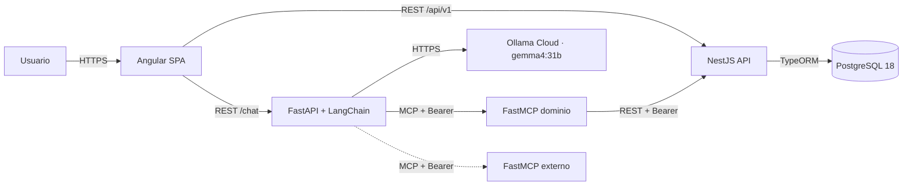

# Lost & Found

Monorepo del proyecto **Lost & Found**: una aplicación para registrar objetos perdidos y encontrados, buscar coincidencias y gestionar solicitudes de recuperación y devoluciones.

> **Estado actual:** Etapa 0.1 — esqueleto inicial del monorepo y documentación.
> Todavía no hay dependencias instaladas, código de aplicación ni base de datos configurada.

## Objetivo

Construir una aplicación full stack con reglas de negocio centralizadas en NestJS, una interfaz Angular y un asistente conversacional que utiliza herramientas MCP sin acceder directamente a PostgreSQL ni duplicar reglas del dominio.

## Casos de uso aprobados

1. Registrar una publicación de objeto perdido.
2. Registrar una publicación de objeto encontrado.
3. Buscar publicaciones.
4. Filtrar y ordenar resultados.
5. Ver el detalle de una publicación.
6. Sugerir coincidencias entre publicaciones perdidas y encontradas.
7. Solicitar la recuperación de un objeto encontrado.
8. Gestionar la devolución de un objeto.
9. Gestionar las publicaciones propias.
10. Usar el asistente conversacional.

## Stack

| Capa | Tecnología | Estado / versión |
|---|---|---|
| Frontend | Angular + TypeScript + SCSS | Se fija en Etapa 0.4 |
| Backend | NestJS + TypeScript + CommonJS | NestJS 12.3.2, TypeScript 6.0.3, Node 24.20.0 |
| Servicio de IA | Python + FastAPI + LangChain | Se fija en Etapa 0.5 |
| LLM | Ollama Cloud, modelo `gemma4:31b` | Configuración en Etapa 0.5 |
| Base de datos | PostgreSQL 18 nativo en Windows | Sin Docker; se configura en Etapa 0.3 |
| Persistencia | TypeORM con migraciones | Se configura en Etapa 0.3 |
| Protocolos | REST + MCP | Diseño documentado |
| Herramientas | Git/GitHub, OpenCode | Git inicializado en esta etapa |

Decisiones y restricciones:

- NestJS es la **única fuente de verdad** para reglas de negocio y acceso a datos.
- El asistente y los servidores MCP **no acceden a PostgreSQL** ni duplican reglas.
- Se requieren **al menos dos servidores o herramientas MCP**, con al menos uno externo.
- Los contratos HTTP de la versión 1 son **TypeScript escritos a mano**; no se generan automáticamente.
- El monorepo es simple: **sin Nx y sin npm workspaces**.
- No se sustituyen tecnologías aprobadas sin autorización explícita.

## Arquitectura en una vista



La arquitectura detallada, los límites entre componentes, la autenticación y el flujo MCP están en [`docs/architecture.md`](docs/architecture.md).

## Estructura del repositorio

```text
.
├── frontend/                 # Angular + SCSS (Etapa 0.4)
├── backend/                  # NestJS API (Etapa 0.2)
├── ai-service/
│   ├── app/                  # FastAPI + LangChain (Etapa 0.5)
│   └── mcp_server/           # Servidor MCP interno de dominio
├── contracts/
│   └── v1/                   # Contratos HTTP TypeScript v1
├── docs/
│   ├── adr/                  # Decisiones de arquitectura
│   ├── architecture.md
│   ├── domain-model.md
│   └── roadmap.md
├── scripts/                  # Scripts de desarrollo
├── .editorconfig
├── .gitattributes
├── .gitignore
├── .nvmrc
├── .prettierignore
├── .prettierrc.json
└── README.md
```

## Documentación

- [`docs/architecture.md`](docs/architecture.md): componentes, flujos, seguridad, persistencia y MCP.
- [`docs/domain-model.md`](docs/domain-model.md): entidades, estados, devoluciones y algoritmo de coincidencias.
- [`docs/roadmap.md`](docs/roadmap.md): etapas de construcción y estado actual.
- [`docs/adr/README.md`](docs/adr/README.md): índice de decisiones de arquitectura.

## Requisitos de entorno

- Node.js **24.20.0** (verificado en Etapa 0.0).
- npm **12.0.2** (verificado en Etapa 0.0).
- Git.
- PostgreSQL **18 nativo en Windows** para las etapas de persistencia. No se usa Docker.

Las versiones de Angular y Python se fijarán en sus etapas de inicialización.

## Etapas

| Etapa | Alcance | Estado |
|---|---|---|
| 0.0 | Verificación NestJS CJS + TypeScript 6 + Node 24 | Aprobada |
| 0.1 | Esqueleto del monorepo y documentación | En revisión |
| 0.2 | Backend NestJS con `/api/health` | Pendiente |
| 0.3 | PostgreSQL + TypeORM + migración base `pg_trgm` | Pendiente |
| 0.4 | Base Angular | Pendiente |
| 0.5 | Base FastAPI sin Ollama, JWT ni MCP | Pendiente |
| 0.6 | Integración, documentación y commit de cierre | Pendiente |

No se avanza a la siguiente etapa sin revisión y autorización.
