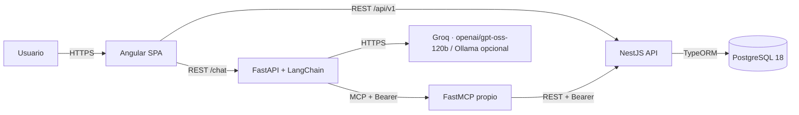
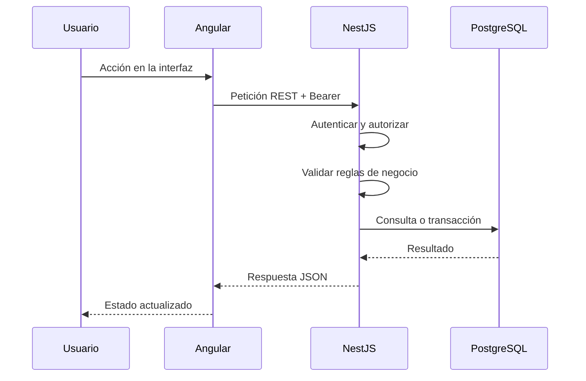
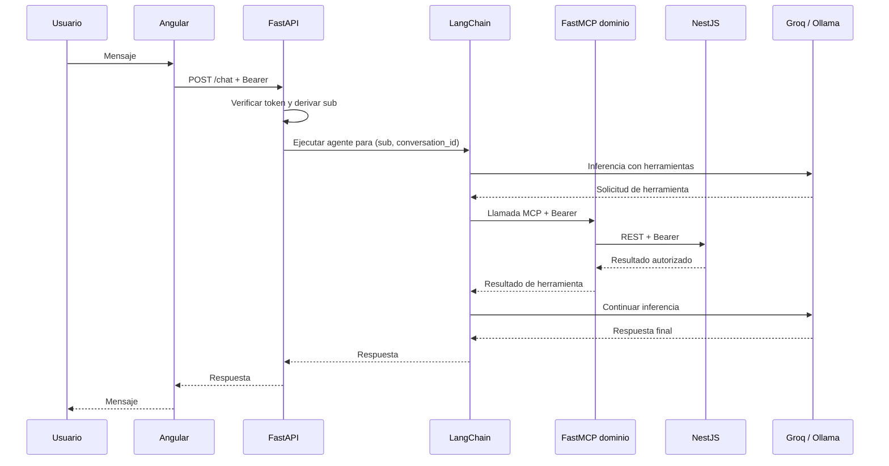

# Arquitectura

## 1. Alcance

Este documento describe la arquitectura objetivo del proyecto **Lost & Found** y también el estado implementado en esta entrega. Las secciones y diagramas marcados como **objetivo** no deben interpretarse como funcionalidad entregada.

El sistema permite registrar objetos perdidos y encontrados, buscar publicaciones, sugerir coincidencias, solicitar recuperaciones, gestionar devoluciones y conversar con un asistente que utiliza herramientas MCP.

## 2. Principios

1. **NestJS es la única fuente de verdad** para reglas de negocio, validaciones de dominio y acceso a datos.
2. **Angular no implementa reglas de negocio**; consume la API REST y presenta el estado.
3. **FastAPI y LangChain orquestan el asistente**, pero no acceden a PostgreSQL ni replican reglas del dominio.
4. **Los servidores MCP son adaptadores delgados**: reciben una petición autenticada, llaman a NestJS y devuelven el resultado.
5. **El usuario autenticado se deriva del token**, nunca de parámetros enviados por el modelo o por el cliente a las herramientas.
6. **Cada petición del asistente se aísla por usuario**: no se comparten adaptadores, clientes MCP, conversaciones ni contexto entre usuarios.
7. **La autenticación es explícita y verificable** en cada salto: NestJS emite, FastAPI y MCP verifican, NestJS vuelve a autorizar.
8. **El avance es incremental y verificable**: cada etapa se revisa y se aprueba antes de continuar.

## 2.1 Estado de esta entrega

**Implementado**

- CU1–CU9: publicaciones, búsqueda, filtros, detalle, coincidencias, solicitudes de recuperación, devoluciones, `COMPLETED`/`RETURNED` y gestión parcial de publicaciones propias.
- CU10: asistente con preparación y confirmación de acciones, FastAPI + LangChain + Groq/Ollama + FastMCP.
- Identidad demo `X-Demo-User-Id` propagada desde Angular hasta NestJS.
- MCP propio con herramientas de contexto y escritura, invocadas después de la confirmación explícita.

**No implementado o parcial**

- CU9: eliminación de publicaciones y gestión integral de solicitudes relacionadas.
- JWT/RS256, login y autenticación de producción.
- Búsqueda, coincidencias o gestión de solicitudes desde el chatbot.
- Confirmación o descarte de coincidencias desde la API/UI.

## 3. Vista de contexto



El diagrama anterior describe la arquitectura objetivo. En la implementación actual, los encabezados `Bearer` se reemplazan por `X-Demo-User-Id`; el MCP propio expone contexto de identidad y herramientas de escritura invocadas por FastAPI después de la confirmación.

El servidor MCP propio participa en la ejecución del chatbot. Los servidores MCP externos son **Context7 y Playwright**, integrados en OpenCode; se usan como herramientas de desarrollo y cumplen el requisito académico sin formar parte de la cadena runtime del asistente.

## 4. Componentes

| Componente | Responsabilidad | No debe hacer |
|---|---|---|
| Angular SPA | Interfaz, navegación, formularios, presentación y llamadas HTTP | Reglas de negocio, acceso a base de datos, decisión de estados |
| NestJS API | Autenticación, autorización, validación, reglas, estados, matching y persistencia | Delegar reglas al asistente |
| FastAPI | Endpoint `/chat`, sesión conversacional, verificación del token, orquestación LangChain | Acceder a PostgreSQL o duplicar validaciones de dominio |
| LangChain | Construcción del agente, invocación del modelo y uso de herramientas MCP | Persistir el dominio o confiar en identificadores enviados por el modelo |
| FastMCP propio | Exponer herramientas de dominio que llaman a NestJS con el token del usuario | Acceder a la base de datos o reimplementar reglas |
| Context7 / Playwright (OpenCode) | Servidores MCP externos para el desarrollo; cumplen el requisito académico | Participar en la cadena runtime del chatbot o recibir secretos del dominio |
| PostgreSQL 18 | Persistencia relacional y soporte de `pg_trgm` | Ser accedido por Angular, FastAPI o MCP |
| Groq / Ollama | Generación de respuestas y uso de herramientas de preparación | Ser la fuente de verdad del dominio |

### 4.1 Frontend

- Angular 22.2.x con TypeScript y SCSS, componentes standalone y formularios reactivos.
- Consume la API REST versionada y el endpoint `/chat` del servicio de IA.
- En esta entrega no hay token de acceso ni JWT. El interceptor de desarrollo agrega `X-Demo-User-Id`; la configuración de producción lo desactiva y la autenticación real queda pendiente.
- El CU1 incorpora el formulario de registro de objetos perdidos en `/lost`, el servicio HTTP y la interceptor de identidad demo.
- El CU2 incorpora el formulario de objetos encontrados en la ruta `/found`, con navegación desde el shell para alternar entre ambos registros; reutiliza categorías, validaciones y costura de identidad del CU1. La pantalla inicial `/` contiene el acceso simulado y no el formulario.
- El CU3 incorpora el listado público con búsqueda y paginación en `/publications` y el detalle en `/publications/:id`, con navegación desde el shell. Consume `GET /api/v1/publications` y `GET /api/v1/publications/:id`; las rutas de CU1 y CU2 quedan intactas.
- El CU4 agrega filtros por tipo, categoría y rango inclusivo de fecha del evento, más orden por más recientes, más antiguas o relevancia. Se aplican con submit explícito, se sincronizan en la URL, se conservan al paginar y `relevance` se deshabilita sin término de búsqueda.
- El CU7 agrega el formulario de solicitud en el detalle de una `FOUND` activa, la acción «Solicitar recuperación» en sugerencias `FOUND`, y las páginas `/recovery-requests` («Mis solicitudes») y `/recovery-requests/received` («Solicitudes recibidas»). Las fechas se rotulan «Creada»/«Última actualización».
- El CU10 agrega la página independiente `/assistant` (`AssistantPageComponent`) y el enlace «Asistente». El nav autenticado queda con siete enlaces: Perdí un objeto, Encontré un objeto, Buscar, Asistente, Mis solicitudes, Recibidas y Mis publicaciones; ADMIN agrega Moderación. Las conversaciones se conservan en localStorage por UUID de perfil demo y no se comparten entre perfiles.
- El acceso inicial en `/` permite registrarse en modo simulado o iniciar sesión con uno de los dos perfiles demo. Las rutas internas requieren una identidad demo activa.

### 4.2 Backend

- NestJS 12.3.2, TypeScript 6.0.3, Node.js 24.20.0 y formato CommonJS.
- Concentra los casos de uso, las máquinas de estado, las validaciones y las consultas.
- **Objetivo no implementado:** emitir JWT con algoritmo RS256. En esta entrega la identidad se resuelve con `X-Demo-User-Id`.
- Expone la API REST bajo `/api/v1` y un endpoint de salud.
- Usa TypeORM 0.3.31 con migraciones explícitas; `synchronize` está deshabilitado.
- El CU1 expone `POST /api/v1/lost-publications` y resuelve la identidad local mediante `CURRENT_USER_RESOLVER` (ver ADR 0008).
- El CU2 expone `POST /api/v1/found-publications` reutilizando la entidad, las validaciones y la identidad del CU1; el servidor fija `type=FOUND`, `status=ACTIVE` y `ownerId`, y rechaza esos campos si vienen en el cuerpo.
- El CU3 expone `GET /api/v1/publications` (listado y búsqueda paginada) y `GET /api/v1/publications/:id` (detalle), lecturas públicas que solo devuelven `status=ACTIVE`. La búsqueda combina `ILIKE` con el operador trigram `%` y fija `pg_trgm.similarity_threshold=0.15` mediante `set_config(..., true)` dentro de la transacción.
- El CU4 extiende la misma consulta con `type`, `category`, `eventDateFrom`, `eventDateTo` y `sort`, combinados con AND y siempre restringidos a `ACTIVE`. `relevance` usa la mayor similitud trigram contra `title`, `description` y `location`; requiere `q` y responde `400 VALIDATION_ERROR` sin él.
- El CU6 expone `GET /api/v1/publications/:id/matches`; la consulta pública devuelve hasta 10 parejas `SUGGESTED` activas del tipo opuesto con score y desglose explicable. La generación se integra transaccionalmente a las altas y un backfill idempotente procesa publicaciones activas preexistentes.
- El CU7 agrega `RecoveryRequestsModule`: creación, listas propias/recibidas, aprobación, rechazo y cancelación. Las operaciones críticas usan transacciones con bloqueo pesimista; la aprobación reserva la publicación, rechaza las demás `PENDING` y garantiza una sola `APPROVED` por publicación. La cancelación de una aprobada verifica la reserva antes de reactivar y aborta sin cambios ante inconsistencia.
- El CU8 agrega la finalización de solicitudes `APPROVED`: registra `completed_at`, `completed_by_id` y notas de devolución, pasa la solicitud a `COMPLETED` y la publicación `FOUND` a `RETURNED`. Solo puede hacerlo el propietario; un ADMIN no propietario no puede completar.
- El CU9 agrega `/api/v1/publications/mine` y `/api/v1/publications/mine/:id`, edición de publicaciones propias `ACTIVE`, cierre lógico `ACTIVE → CLOSED`, y moderación de publicaciones `ACTIVE` de otros usuarios para ADMIN. No implementa eliminación ni gestión global de solicitudes.

### 4.3 Servicio de IA

- Python + FastAPI + LangChain.
- Expone `/health`, `/chat`, `/chat/confirm`, `/chat/cancel`, `/chat/actions/{action_id}` y `/chat/conversations/{conversation_id}/archive`.
- CU10 prepara publicaciones perdidas, encontradas y solicitudes de recuperación mediante herramientas de preparación en memoria.
- Muestra una vista previa y exige confirmación explícita antes de ejecutar.
- FastAPI invoca las herramientas MCP de escritura únicamente después de la confirmación; el modelo no ejecuta escrituras directamente.
- Obtiene el rol del usuario mediante el MCP propio antes de invocar al modelo; el rol lo determina NestJS.
- Usa `X-Demo-User-Id` mientras `AUTH_MODE=demo`; JWT RS256 sigue fuera de alcance.
- Inicializa el modelo de forma diferida para que `/health` funcione sin la API key del proveedor seleccionado.
- No tiene acceso directo a la base de datos ni implementa reglas de negocio.

Proveedores LLM disponibles:

- `LLM_PROVIDER=groq` (predeterminado): `ChatGroq`, modelo `openai/gpt-oss-120b`, API key `GROQ_API_KEY`.
- `LLM_PROVIDER=ollama`: `ChatOllama`, modelo `gemma4:31b`, endpoint `https://ollama.com` y API key `OLLAMA_API_KEY`.
- `ChatGroq` recibe la API key mediante `api_key`; Ollama conserva sus cabeceras `client_kwargs`/`async_client_kwargs`.
- Ambos usan temperatura `0.2` y el mismo flujo de `bind_tools`.
- Versiones implementadas: Python 3.12.1, FastAPI 0.162.1, LangChain 1.4.8, `langchain-groq` 1.1.3, `langchain-ollama` 1.1.0, `langchain-mcp-adapters` 0.3.2, FastMCP 3.4.11 y MCP 1.30.0.

### 4.4 MCP

El requisito mínimo es:

- Al menos dos servidores o herramientas MCP.
- Al menos uno externo.

Diseño aprobado:

- **Servidor MCP propio del proyecto:** expone `get_user_context`, que delega en NestJS usando `X-Demo-User-Id`, y tres herramientas de escritura invocadas por FastAPI después de una confirmación explícita. No expone herramientas de búsqueda ni gestión.
- **Servidores MCP externos:** **Context7** y **Playwright**, integrados en OpenCode. Se usan como herramientas de desarrollo y son los que cumplen el requisito académico de contar con MCP externo. No forman parte de la cadena runtime del chatbot ni reciben secretos del dominio.

Esta decisión está aprobada y no requiere confirmación adicional del docente.

Los servidores MCP no reciben `userId` ni `role` como parámetros de herramienta. El usuario se obtiene del token verificado.

### 4.5 PostgreSQL

- PostgreSQL 18 nativo en Windows, sin Docker.
- Base de desarrollo `lostfound_dev`, propietario `lostfound_app`; la contraseña se ingresa localmente y no se versiona.
- TypeORM 0.3.31 con migraciones; no se usará `synchronize`.
- La migración base incluye la extensión `pg_trgm`, las tablas `users` y `publications`, restricciones `CHECK`, la clave foránea `owner_id`, el índice de `owner_id` y el seed idempotente del usuario demo.
- El CU3 agrega en una migración aditiva y reversible los índices GIN trigram de `title`, `description` y `location`, y el índice B-tree `(status, created_at DESC)`.
- El CU4 no agrega migraciones ni índices: reutiliza los índices trigram y el índice `(status, created_at DESC)` del CU3. Los índices compuestos para combinaciones de filtros quedan diferidos hasta medir necesidad.
- El CU6 agrega `search_text` como columna generada almacenada con índice GIN `pg_trgm`, además de `publication_matches`, la pareja única y sus índices de consulta. No elimina ni reemplaza los índices de CU3/CU4; `synchronize` continúa deshabilitado.
- El CU7 agrega en una migración aditiva y reversible `recovery_requests`, FKs `ON DELETE RESTRICT`, checks de estado/cancelación, un índice único parcial por publicación+solicitante para solicitudes activas, un índice único parcial de una `APPROVED` por publicación e índices de consulta. No modifica tablas de CU1–CU6.
- El acceso queda restringido a NestJS.

### 4.6 Proveedores LLM

- Groq es el proveedor predeterminado; Ollama queda disponible como alternativa.
- La selección se realiza con `LLM_PROVIDER=groq` u `LLM_PROVIDER=ollama`.
- Groq usa `openai/gpt-oss-120b` por defecto.
- Ollama conserva `gemma4:31b` como modelo configurado.
- Las API keys se manejan como secretos del servicio de IA y no se exponen al frontend.
- Ambos proveedores usan el mismo flujo de mensajes, `bind_tools` y confirmación de CU10.

## 5. Flujos

### 5.1 Operaciones REST y búsqueda



### 5.2 Asistente conversacional — flujo objetivo



### 5.2.1 Estado real de CU10

CU10 usa la costura demo aprobada, no JWT. El flujo real es:

```text
Angular /assistant
  → FastAPI POST /chat (X-Demo-User-Id)
  → MCP get_user_context (mismo encabezado)
  → NestJS GET /api/v1/assistant/context
  → FastAPI construye el prompt con el rol
  → LLM seleccionado por LLM_PROVIDER (Groq por defecto u Ollama)
  → Angular muestra la respuesta
```

El modelo solo recibe las herramientas de preparación; no ejecuta escrituras
directamente y no puede cambiar el rol. La ejecución ocurre después de la
confirmación explícita en la interfaz. Las conversaciones se conservan en
localStorage por UUID de perfil demo; el servidor no las persiste.

### 5.3 Llamada MCP — flujo objetivo

1. FastAPI recibe el token del usuario y verifica su firma, expiración y audiencia.
2. FastAPI deriva `sub` y `role` del token; no los acepta desde el cuerpo de la petición.
3. FastAPI crea o reutiliza únicamente el contexto de la conversación identificada por `(sub, conversation_id)`.
4. LangChain crea un `MCPAdapter`, cliente y herramientas por petición; no se cachean entre usuarios.
5. El token en bruto se reenvía al servidor MCP como `Authorization: Bearer ...`.
6. El servidor MCP vuelve a verificar el token y llama a NestJS con el mismo token.
7. NestJS autentica, autoriza y aplica las reglas de negocio.
8. La respuesta vuelve al agente sin incluir secretos ni datos de otro usuario.

## 6. Seguridad y autenticación

### 6.1 Emisión — objetivo no implementado

- NestJS es el único emisor de tokens en la arquitectura objetivo. Esta entrega no emite JWT.
- Algoritmo: **RS256**.
- La clave privada permanece exclusivamente en el backend.
- FastAPI y los servidores MCP verifican con una clave pública estática.
- Vida útil del token: **30 minutos**.
- No hay refresh token en la versión 1.
- Audiencia: `aud=lostfound-api`.
- Claims previstos: `sub`, `role`, `aud`, `iss`, `iat`, `exp`.
- Rotación de claves manual; JWKS queda para una versión posterior.

### 6.2 Propagación

El token en bruto se propaga en cadena:

```text
Angular -> FastAPI /chat -> LangChain MCPAdapter -> FastMCP -> NestJS
```

Reglas:

- No se agregan `userId` ni `role` como parámetros de herramientas.
- No se confía en identificadores enviados por el modelo.
- Cada llamada se revalida; no alcanza con validar al inicio de la conversación.
- No se registran tokens completos en logs.
- Los errores de autenticación no revelan detalles internos de claves.

### 6.3 Aislamiento

- Las conversaciones se indexan por `(sub, conversation_id)`.
- El `conversation_id` no es suficiente por sí solo; siempre se combina con el `sub` autenticado.
- El estado de una conversación no puede ser leído por otro usuario aunque adivine el identificador.
- En la arquitectura objetivo se usa MCP 2026-07-28, que es *sessionless*. La implementación actual de CU10 usa MCP 1.30.0 con FastMCP 3.4.11.
- El vínculo de sesión de FastMCP, si existe, es defensa en profundidad para clientes legados, no el mecanismo principal.

### 6.4 Identidad local de demostración

Mientras no exista JWT RS256, CU1–CU10 usan una costura temporal documentada en la ADR 0008:

- El cliente envía `X-Demo-User-Id`; el backend lo resuelve con `DemoIdentityResolver` detrás de `CURRENT_USER_RESOLVER`.
- No es autenticación, no aporta confidencialidad ni autorización real y no reemplaza la verificación del token.
- `AUTH_MODE=demo` se rechaza al arrancar cuando `NODE_ENV=production`; el frontend de producción no envía el encabezado.
- La futura integración JWT reemplaza solo el proveedor de `CURRENT_USER_RESOLVER`.
- CU10 reutiliza esta costura para propagar la identidad hasta FastAPI/MCP; el rol se resuelve en NestJS.

## 7. Persistencia y migraciones

- PostgreSQL 18 nativo en Windows.
- TypeORM como capa de acceso y migraciones.
- Sin `synchronize` en ningún entorno.
- La línea base de migraciones se crea con el CU1.
- El CLI de TypeORM compila primero y ejecuta contra `dist/database/data-source.js`; no se depende de `ts-node` con TypeScript 6.
- Comandos: `npm run db:migrate`, `npm run db:revert` y `npm run db:show` desde `backend/`.
- La extensión `pg_trgm` forma parte de la migración base. Los índices trigram de búsqueda se agregan en la migración aditiva del CU3.
- El CU4 no agrega migraciones: reutiliza `publications_status_created_at_idx` y los tres índices GIN trigram del CU3. Los índices compuestos para `type`, `category` o `event_date` quedan como candidatos futuros sujetos a medición.
- Las migraciones deben ser reproducibles y reversibles cuando sea razonable.

## 8. API y contratos

- REST versionado bajo `/api/v1`.
- Respuestas JSON y errores consistentes.
- Contratos HTTP v1 escritos a mano en TypeScript, ubicados en `contracts/v1`.
- Angular y NestJS consumen esos contratos; FastAPI mantiene modelos equivalentes en Python.
- No se genera código automáticamente en la versión 1.
- Los contratos no exponen detalles internos de persistencia ni secretos.
- CU1: `POST /api/v1/lost-publications` crea una publicación `LOST`/`ACTIVE` y responde `201` con el recurso. Los errores usan `{ statusCode, code, message, details? }`; la validación devuelve `code=VALIDATION_ERROR` y un detalle por campo.
- CU2: `POST /api/v1/found-publications` crea una publicación `FOUND`/`ACTIVE` con las mismas validaciones, identidad y contrato de errores que el CU1. Los campos `type`, `status` y `ownerId` los fija el servidor y se rechazan si llegan en el cuerpo.
- CU3: `GET /api/v1/publications` lista y busca publicaciones `ACTIVE` con `q`, `page` y `pageSize` (1/12/50, orden `createdAt DESC, id DESC`); `GET /api/v1/publications/:id` devuelve el detalle solo si está `ACTIVE`. Ambos son públicos, no exponen `ownerId` y responden `404 PUBLICATION_NOT_FOUND` para inexistentes o no activas.
- CU4: el listado agrega `type`, `category`, `eventDateFrom`, `eventDateTo` y `sort` (`recent`/`oldest`/`relevance`) al mismo `GET /api/v1/publications`, combinados con AND con `q`. `status` sigue sin ser un parámetro aceptado y solo se exponen publicaciones `ACTIVE`. `sort=relevance` requiere `q`; sin término responde `400 VALIDATION_ERROR` con detalle en `sort`.
- CU6: `GET /api/v1/publications/:id/matches` devuelve sugerencias públicas del tipo opuesto, solo si fuente y candidata siguen `ACTIVE`, con score/desglose y sin `ownerId`. Las altas generan sugerencias persistidas de forma transaccional; el backfill cubre publicaciones activas preexistentes.
- CU7: los endpoints de solicitudes requieren identidad demo y usan `{ statusCode, code, message, details? }`. Publicación inexistente/no `ACTIVE`/no `FOUND` responde `404 PUBLICATION_NOT_FOUND`; no existe `PUBLICATION_NOT_AVAILABLE`. Los errores de solicitud son `RECOVERY_REQUEST_NOT_FOUND` (404), `RECOVERY_REQUEST_FORBIDDEN` (403), `RECOVERY_REQUEST_DUPLICATE`, `RECOVERY_REQUEST_NOT_PENDING`, `RECOVERY_REQUEST_NOT_CANCELLABLE` y `RECOVERY_REQUEST_CONFLICT` (409). Las respuestas no exponen `ownerId`, `requesterId`, `cancelledById`, correo ni contacto; `updatedAt` es última modificación, no fecha de decisión.
- CU10: `GET /api/v1/assistant/context` (NestJS) devuelve `{ role }`; FastAPI expone `/chat`, `/chat/confirm`, `/chat/cancel`, `/chat/actions/{action_id}` y `/chat/conversations/{conversation_id}/archive`. El asistente prepara publicaciones y solicitudes, muestra una vista previa y ejecuta mediante MCP solo después de confirmación explícita. Errores: 400 `VALIDATION_ERROR`, 401 `DEMO_IDENTITY_REQUIRED`/`DEMO_IDENTITY_INVALID`, 409 de acciones/archivado, 502 `ASSISTANT_UPSTREAM_ERROR`, 503 `ASSISTANT_UNAVAILABLE`.

## 9. Entorno local

- Node.js 24.20.0 y npm 12.0.2.
- TypeScript 6.0.3.
- NestJS 12.3.2.
- Jest 30.5.2 y `ts-jest` 29.4.15 para el backend.
- Angular 22.2.x y Vitest 5.1.0 para el frontend.
- TypeORM 0.3.31 y `pg` 8.23.1 para PostgreSQL.
- PostgreSQL 18.6 instalado de forma nativa en Windows; sin contenedores.
- Git para control de versiones.
- OpenCode como entorno de asistencia al desarrollo.

La Etapa 0.0 verificó la combinación NestJS 12 + CommonJS + TypeScript 6.0.3 + Node 24.20.0 en una carpeta temporal descartable. El backend definitivo comienza en la Etapa 0.2.

## 10. Riesgos y pruebas de concepto obligatorias

Antes de declarar funcional una capacidad, deben resolverse y documentarse estas verificaciones:

1. TypeORM CLI con TypeScript 6.0.3 sin `ts-node`.
2. Comportamiento real de `pg_trgm` con el umbral `0.15` y los índices definidos. Verificado en CU3.
3. **Objetivo pendiente:** cadena RS256 NestJS → FastAPI → LangChain → FastMCP → NestJS.
4. **Objetivo pendiente:** propagación de token y autorización en cada salto.
5. **Objetivo pendiente:** aislamiento entre dos usuarios con JWT y rechazo de tokens vencidos o inválidos.
6. **Objetivo pendiente:** ausencia de adaptadores MCP cacheados entre usuarios con autenticación real.
7. **Verificado en CU10:** FastMCP 3.4.11 + MCP 1.30.0 + `langchain-mcp-adapters` 0.3.2 con herramientas reales y propagación de `X-Demo-User-Id`.
8. **Verificado en CU10:** resolución de dependencias Python para FastAPI, FastMCP y el adaptador MCP.
9. **Verificado en CU10:** el flujo de tool calling usa el formato estándar de LangChain (`AIMessage.tool_calls` y `ToolMessage`). La conexión real con Groq queda pendiente de validar con una API key configurada.

La cadena MCP con JWT y aislamiento entre dos usuarios sigue pendiente para una etapa de autenticación real. CU10 validó una variante de demostración con identidad `X-Demo-User-Id`.
