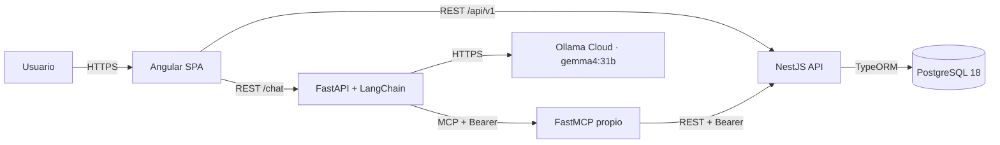
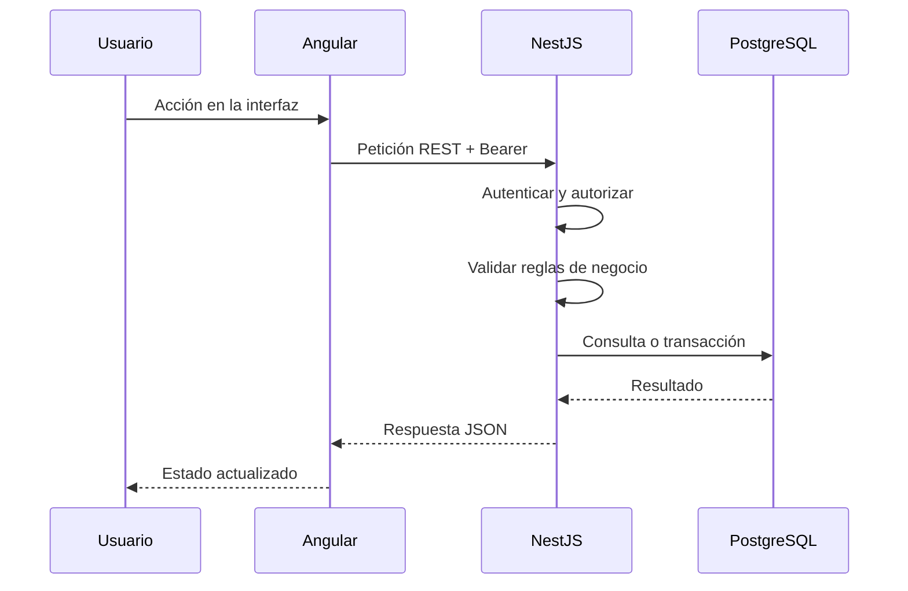

# Arquitectura

## 1. Alcance

Este documento describe la arquitectura objetivo del proyecto **Lost & Found** y las decisiones que estructuran su construcción incremental. La Etapa 0.1 crea el esqueleto del repositorio y esta documentación; no implementa todavía ninguno de los componentes.

El sistema permite registrar objetos perdidos y encontrados, buscar publicaciones, sugerir coincidencias, solicitar recuperaciones, gestionar devoluciones y conversar con un asistente que utiliza herramientas MCP.

## 2. Principios

1. **NestJS es la única fuente de verdad** para reglas de negocio, validaciones de dominio y acceso a datos.
2. **Angular no implementa reglas de negocio**; consume la API REST y presenta el estado.
3. **FastAPI y LangChain orquestan el asistente**, pero no acceden a PostgreSQL ni replican reglas del dominio.
4. **Los servidores MCP son adaptadores delgados**: reciben una petición autenticada, llaman a NestJS y devuelven el resultado.
5. **El usuario autenticado se deriva del token**, nunca de parámetros enviados por el modelo o por el cliente a las herramientas.
6. **Cada petición del asistente se aísla por usuario**: no se comparten adaptadores, clientes MCP, conversaciones ni contexto entre usuarios.
7. **La autenticación es explícita y verificable** en cada salto: NestJS emite, FastAPI y MCP verifican, NestJS vuelve a autorizar.
8. **El avance es incremental y verificable**: cada etapa se revisa y se aprueba antes de continuar.

## 3. Vista de contexto



El servidor MCP propio participa en la ejecución del chatbot. Los servidores MCP externos son **Context7 y Playwright**, integrados en OpenCode; se usan como herramientas de desarrollo y cumplen el requisito académico sin formar parte de la cadena runtime del asistente.

## 4. Componentes

| Componente | Responsabilidad | No debe hacer |
|---|---|---|
| Angular SPA | Interfaz, navegación, formularios, presentación y llamadas HTTP | Reglas de negocio, acceso a base de datos, decisión de estados |
| NestJS API | Autenticación, autorización, validación, reglas, estados, matching y persistencia | Delegar reglas al asistente |
| FastAPI | Endpoint `/chat`, sesión conversacional, verificación del token, orquestación LangChain | Acceder a PostgreSQL o duplicar validaciones de dominio |
| LangChain | Construcción del agente, invocación del modelo y uso de herramientas MCP | Persistir el dominio o confiar en identificadores enviados por el modelo |
| FastMCP propio | Exponer herramientas de dominio que llaman a NestJS con el token del usuario | Acceder a la base de datos o reimplementar reglas |
| Context7 / Playwright (OpenCode) | Servidores MCP externos para el desarrollo; cumplen el requisito académico | Participar en la cadena runtime del chatbot o recibir secretos del dominio |
| PostgreSQL 18 | Persistencia relacional y soporte de `pg_trgm` | Ser accedido por Angular, FastAPI o MCP |
| Ollama Cloud | Generación de respuestas y uso de herramientas | Ser la fuente de verdad del dominio |

### 4.1 Frontend

- Angular con TypeScript y SCSS.
- Consumirá la API REST versionada y el endpoint `/chat` del servicio de IA.
- Mantendrá el token de acceso en el mecanismo que se defina en la etapa de autenticación; no se almacenarán secretos de firma en el navegador.
- La versión exacta de Angular se fijará en la Etapa 0.4.

### 4.2 Backend

- NestJS 12.3.2, TypeScript 6.0.3, Node.js 24.20.0 y formato CommonJS.
- Concentra los casos de uso, las máquinas de estado, las validaciones y las consultas.
- Emite los JWT con algoritmo RS256.
- Expone la API REST bajo `/api/v1` y, en la Etapa 0.2, un endpoint de salud.
- La configuración de TypeORM y PostgreSQL comienza en la Etapa 0.3.

### 4.3 Servicio de IA

- Python + FastAPI + LangChain.
- Expone `/chat` y orquesta el ciclo conversacional.
- Verifica el JWT del usuario antes de procesar la petición.
- Inicializa el modelo de Ollama Cloud de forma diferida para que el endpoint de salud funcione sin `OLLAMA_API_KEY`.
- No tiene acceso directo a la base de datos ni implementa reglas de negocio.

Configuración prevista de Ollama Cloud:

- Endpoint: `https://ollama.com/api/chat`.
- Autenticación: `Authorization: Bearer $OLLAMA_API_KEY`.
- Modelo: `gemma4:31b`.
- `ChatOllama` con `base_url`, cabeceras mediante `client_kwargs`/`async_client_kwargs` y `validate_model_on_init=False`.
- Las versiones exactas de Python, FastAPI, LangChain y FastMCP se fijarán y verificarán en la Etapa 0.5 y en la PoC MCP.

### 4.4 MCP

El requisito mínimo es:

- Al menos dos servidores o herramientas MCP.
- Al menos uno externo.

Diseño aprobado:

- **Servidor MCP propio del proyecto:** expone herramientas de consulta y apoyo (por ejemplo, búsqueda, detalle y sugerencias) que delegan en la API NestJS usando el token del usuario. Es el servidor que se utiliza durante la ejecución del chatbot.
- **Servidores MCP externos:** **Context7** y **Playwright**, integrados en OpenCode. Se usan como herramientas de desarrollo y son los que cumplen el requisito académico de contar con MCP externo. No forman parte de la cadena runtime del chatbot ni reciben secretos del dominio.

Esta decisión está aprobada y no requiere confirmación adicional del docente.

Los servidores MCP no reciben `userId` ni `role` como parámetros de herramienta. El usuario se obtiene del token verificado.

### 4.5 PostgreSQL

- PostgreSQL 18 nativo en Windows, sin Docker.
- TypeORM con migraciones; no se usará `synchronize`.
- La migración base incluirá la extensión `pg_trgm` y los índices necesarios para la búsqueda.
- El acceso queda restringido a NestJS.

### 4.6 Ollama Cloud

- Proveedor de inferencia del asistente.
- El modelo aprobado es `gemma4:31b`.
- La API key se maneja como secreto del servicio de IA y no se expone al frontend.
- La disponibilidad de *tool calling* y *streaming* se validará en la PoC.

## 5. Flujos

### 5.1 Operaciones REST y búsqueda



### 5.2 Asistente conversacional


### 5.3 Llamada MCP

1. FastAPI recibe el token del usuario y verifica su firma, expiración y audiencia.
2. FastAPI deriva `sub` y `role` del token; no los acepta desde el cuerpo de la petición.
3. FastAPI crea o reutiliza únicamente el contexto de la conversación identificada por `(sub, conversation_id)`.
4. LangChain crea un `MCPAdapter`, cliente y herramientas por petición; no se cachean entre usuarios.
5. El token en bruto se reenvía al servidor MCP como `Authorization: Bearer ...`.
6. El servidor MCP vuelve a verificar el token y llama a NestJS con el mismo token.
7. NestJS autentica, autoriza y aplica las reglas de negocio.
8. La respuesta vuelve al agente sin incluir secretos ni datos de otro usuario.

## 6. Seguridad y autenticación

### 6.1 Emisión

- NestJS es el único emisor de tokens.
- Algoritmo: **RS256**.
- La clave privada permanece exclusivamente en el backend.
- FastAPI y los servidores MCP verifican con una clave pública estática.
- Vida útil del token: **30 minutos**.
- No hay refresh token en la versión 1.
- Audiencia: `aud=lostfound-api`.
- Claims previstos: `sub`, `role`, `aud`, `iss`, `iat`, `exp`.
- Rotación de claves manual; JWKS queda para una versión posterior.

### 6.2 Propagación

El token en bruto se propaga en cadena:

```text
Angular -> FastAPI /chat -> LangChain MCPAdapter -> FastMCP -> NestJS
```

Reglas:

- No se agregan `userId` ni `role` como parámetros de herramientas.
- No se confía en identificadores enviados por el modelo.
- Cada llamada se revalida; no alcanza con validar al inicio de la conversación.
- No se registran tokens completos en logs.
- Los errores de autenticación no revelan detalles internos de claves.

### 6.3 Aislamiento

- Las conversaciones se indexan por `(sub, conversation_id)`.
- El `conversation_id` no es suficiente por sí solo; siempre se combina con el `sub` autenticado.
- El estado de una conversación no puede ser leído por otro usuario aunque adivine el identificador.
- No se depende de `Mcp-Session-Id` para el aislamiento: MCP 2026-07-28 es *sessionless*.
- El vínculo de sesión de FastMCP, si existe, es defensa en profundidad para clientes legados, no el mecanismo principal.

## 7. Persistencia y migraciones

- PostgreSQL 18 nativo en Windows.
- TypeORM como capa de acceso y migraciones.
- Sin `synchronize` en ningún entorno.
- La línea base de migraciones se crea en la Etapa 0.3.
- Para el CLI de TypeORM se prevé compilar primero y ejecutar contra `dist/database/data-source.js`; no se dependerá de `ts-node` con TypeScript 6 sin verificarlo.
- La extensión `pg_trgm` y sus índices forman parte de la migración base.
- Las migraciones deben ser reproducibles y reversibles cuando sea razonable.

## 8. API y contratos

- REST versionado bajo `/api/v1`.
- Respuestas JSON y errores consistentes.
- Contratos HTTP v1 escritos a mano en TypeScript, ubicados en `contracts/v1`.
- Angular y NestJS consumen esos contratos; FastAPI mantiene modelos equivalentes en Python.
- No se genera código automáticamente en la versión 1.
- Los contratos no exponen detalles internos de persistencia ni secretos.

## 9. Entorno local

- Node.js 24.20.0 y npm 12.0.2.
- TypeScript 6.0.3.
- NestJS 12.3.2.
- Jest 30.5.2 y `ts-jest` 29.4.15 para el backend.
- PostgreSQL 18 instalado de forma nativa en Windows; sin contenedores.
- Git para control de versiones.
- OpenCode como entorno de asistencia al desarrollo.

La Etapa 0.0 verificó la combinación NestJS 12 + CommonJS + TypeScript 6.0.3 + Node 24.20.0 en una carpeta temporal descartable. El backend definitivo comienza en la Etapa 0.2.

## 10. Riesgos y pruebas de concepto obligatorias

Antes de declarar funcional una capacidad, deben resolverse y documentarse estas verificaciones:

1. TypeORM CLI con TypeScript 6.0.3 sin `ts-node`.
2. Comportamiento real de `pg_trgm` con el umbral `0.15` y los índices definidos.
3. Cadena RS256: NestJS -> FastAPI -> LangChain -> FastMCP -> NestJS.
4. Propagación del token y autorización en cada salto.
5. Aislamiento entre dos usuarios y rechazo de tokens vencidos o inválidos.
6. Ausencia de adaptadores MCP cacheados entre usuarios.
7. Compatibilidad de LangChain, FastMCP y MCP 2026-07-28.
8. Resolución de dependencias Python entre FastAPI, FastMCP y Starlette.
9. *Tool calling* y *streaming* de Ollama Cloud con `gemma4:31b`.

La cadena MCP no se considerará funcional hasta completar una PoC aislada con dos usuarios, tokens válidos, inválidos y vencidos, y verificación de que no hay estado compartido.
