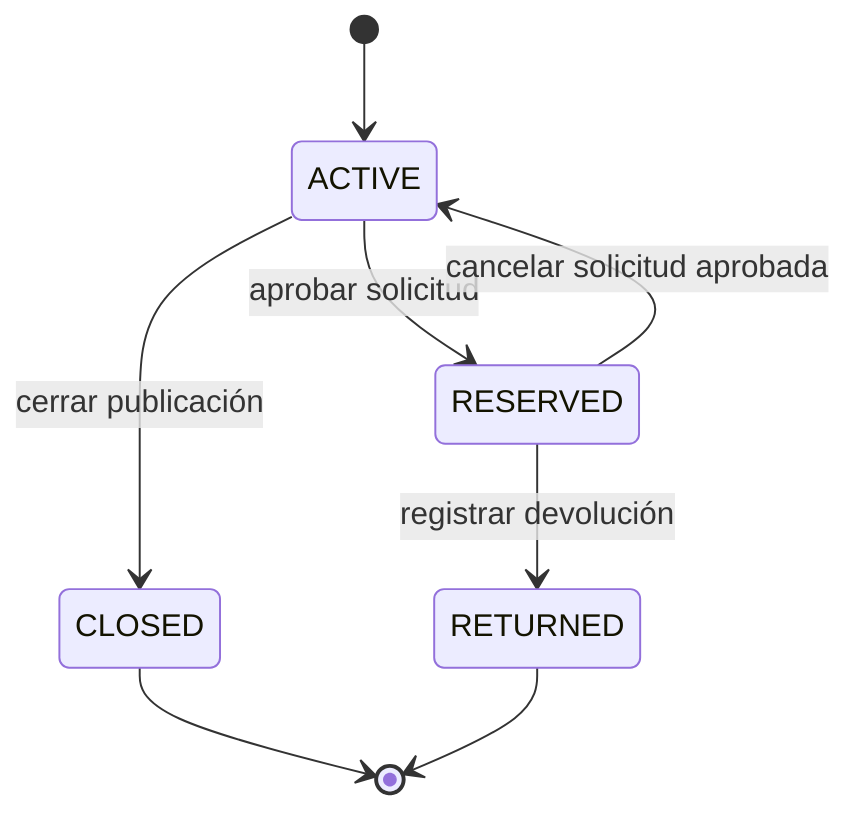
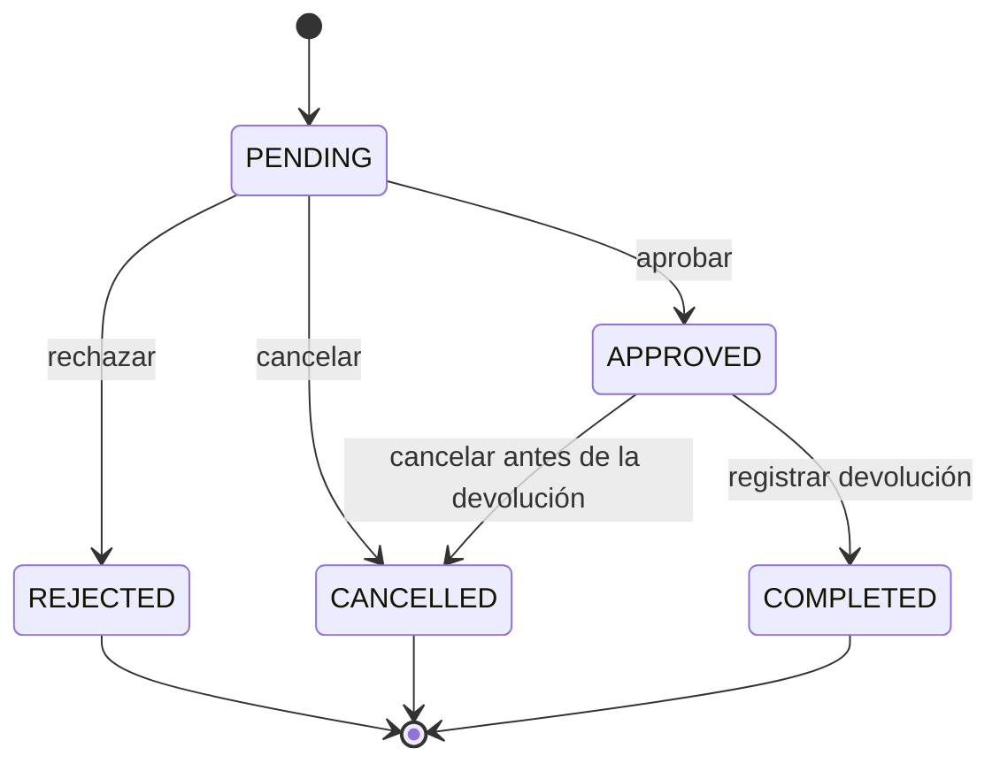
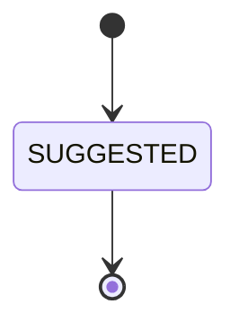

# Modelo de dominio

## 1. Actores

| Actor | Descripción |
|---|---|
| Usuario autenticado | Persona con una cuenta; puede registrar publicaciones, buscar, solicitar recuperaciones y usar el asistente. |
| Propietario de una publicación | Usuario que registró la publicación. Puede gestionarla según su estado. |
| Solicitante | Usuario que pide recuperar un objeto encontrado. No puede ser el propietario de esa publicación. |
| Administrador | Puede listar y cerrar publicaciones `ACTIVE` de otros usuarios. No puede completar devoluciones de publicaciones ajenas. |

El objetivo de arquitectura es identificar al usuario por el claim `sub` de un JWT. En esta entrega no hay JWT implementado: la identidad se resuelve mediante la costura de demostración `X-Demo-User-Id` (ADR 0008 y ADR 0011). Las herramientas del asistente no reciben `userId` ni `role` como parámetros.

## 2. Casos de uso

| # | Caso de uso | Componente que aplica las reglas |
|---|---|---|
| 1 | Registrar una publicación perdida | NestJS |
| 2 | Registrar una publicación encontrada | NestJS |
| 3 | Buscar publicaciones | NestJS |
| 4 | Filtrar y ordenar resultados | NestJS |
| 5 | Ver el detalle de una publicación | NestJS |
| 6 | Sugerir coincidencias | NestJS |
| 7 | Solicitar recuperación | NestJS |
| 8 | Gestionar devolución | NestJS |
| 9 | Gestionar publicaciones propias | NestJS |
| 10 | Usar el asistente | FastAPI + LangChain + MCP, delegando reglas en NestJS |

### Estado de esta entrega

- CU1–CU10 están implementados, con el alcance parcial de CU9 y las limitaciones de CU10 documentadas abajo.
- CU8 (devoluciones) está implementado mediante la finalización de solicitudes: `APPROVED → COMPLETED` y publicación `RESERVED → RETURNED`.
- CU9 (gestión de publicaciones propias) está implementado parcialmente: consulta, edición y cierre de publicaciones propias activas. La eliminación no está implementada y la gestión de solicitudes relacionadas quedó parcial.
- Las coincidencias implementadas se muestran como `SUGGESTED`; no existen endpoints de confirmación o descarte.

## 3. Entidades principales

### 3.1 Publicación

Representa un objeto perdido o encontrado.

| Campo | Descripción |
|---|---|
| `id` | Identificador de la publicación. |
| `type` | `LOST` o `FOUND`. |
| `status` | `ACTIVE`, `RESERVED`, `RETURNED` o `CLOSED`. |
| `owner_id` | Usuario propietario de la publicación. |
| `title` | Título breve. |
| `description` | Descripción del objeto. |
| `category` | Categoría; es una señal blanda para las coincidencias. |
| `location` | Lugar donde se perdió o encontró. |
| `event_date` | Fecha del evento. |
| `search_text` | Columna generada almacenada a partir de título, descripción y ubicación, normalizada para la búsqueda y el prefiltro de coincidencias. |
| `created_at`, `updated_at` | Marcas temporales. |

### 3.2 Solicitud de recuperación

Representa el pedido de un usuario para recuperar una publicación de tipo `FOUND`.

| Campo | Descripción |
|---|---|
| `id` | Identificador de la solicitud. |
| `publication_id` | Publicación encontrada asociada. |
| `requester_id` | Usuario que solicita la recuperación. |
| `status` | `PENDING`, `APPROVED`, `REJECTED`, `CANCELLED` o `COMPLETED`. |
| `notes` | Notas opcionales del solicitante (máximo 500 caracteres, recortadas). |
| `cancelled_by_id` | Actor que canceló, si corresponde. |
| `cancellation_reason` | Motivo obligatorio de la cancelación (3–500 caracteres), si corresponde. |
| `created_at` | Fecha de creación de la solicitud. |
| `updated_at` | Última modificación de la fila; no es la fecha de aprobación, rechazo ni cancelación. |

Reglas:

- Solo se crean sobre publicaciones `FOUND` `ACTIVE`.
- El solicitante no puede ser el propietario de la publicación.
- Una publicación `RESERVED` no admite nuevas solicitudes ni aprobaciones.
- Solo puede existir una solicitud `PENDING`/`APPROVED` por publicación y solicitante.
- Solo puede existir una solicitud `APPROVED` por publicación.
- Aprobar una solicitud pone la publicación en `RESERVED` y rechaza las demás solicitudes pendientes de esa publicación dentro de una única transacción.
- Cancelar una `APPROVED` verifica que la publicación siga `RESERVED` y que esa solicitud sea la única aprobada antes de reactivarla; ante inconsistencia no reactiva.
- Toda cancelación registra actor y motivo; el motivo lo aporta el actor y se valida entre 3 y 500 caracteres.

### 3.3 Devolución — CU8 implementado

La devolución se registra completando una solicitud de recuperación `APPROVED`. No existe una tabla `devoluciones` separada; los datos de cierre se almacenan en `recovery_requests`:

| Campo | Descripción |
|---|---|
| `completed_at` | Fecha de finalización. |
| `completed_by_id` | Usuario que registra la devolución. |
| `return_notes` | Notas opcionales de devolución, hasta 500 caracteres. |

Reglas:

- Solo el propietario de la publicación puede completar la solicitud.
- Un ADMIN solo puede completarla si además es el propietario.
- La solicitud debe estar `APPROVED` y la publicación debe estar `RESERVED`.
- La operación es transaccional: la solicitud pasa a `COMPLETED` y la publicación a `RETURNED`.
- No se admite completar una solicitud ya `COMPLETED` ni una solicitud que no esté `APPROVED`.
- La entrega se registra como una operación de un solo paso en esta versión.

### 3.4 Coincidencia

Representa una sugerencia entre una publicación perdida y una encontrada.

| Campo | Descripción |
|---|---|
| `id` | Identificador de la coincidencia. |
| `lost_publication_id` | Publicación de tipo `LOST`. |
| `found_publication_id` | Publicación de tipo `FOUND`. |
| `status` | `SUGGESTED`, `CONFIRMED` o `DISMISSED`. |
| `score` | Puntaje calculado por NestJS. |
| `created_at`, `updated_at` | Marcas temporales. |

La tabla `publication_matches` mantiene una pareja única LOST/FOUND, el score
normalizado y el estado. En esta entrega todas las coincidencias persistidas y
expuestas por la API son `SUGGESTED`; no existen endpoints para confirmar ni
descartar coincidencias. No persiste `owner_id`, detalles de usuario ni un
estado `INVALIDATED`.

No existe el estado `INVALIDATED`. Una coincidencia es **accionable** si ambas publicaciones siguen en estado `ACTIVE`; esa condición se deriva y no se almacena como un estado adicional.

## 4. Máquinas de estado

> Las transiciones `RESERVED → RETURNED` y `APPROVED → COMPLETED` están implementadas. CU9 permite cerrar publicaciones propias `ACTIVE`; no implementa eliminación. La gestión de solicitudes relacionadas quedó parcial.

### 4.1 Publicación



Reglas:

- `RESERVED -> RETURNED` solo ocurre mediante el registro de una devolución.
- El propietario no puede cerrar una publicación `RESERVED`.
- El cierre lógico solo se permite sobre publicaciones `ACTIVE`.
- Al cancelar una solicitud aprobada, la publicación vuelve a `ACTIVE`.
- La publicación `RETURNED` representa una devolución completada en la versión 1.

### 4.2 Solicitud de recuperación



Reglas:

- El solicitante puede cancelar su propia solicitud `PENDING`.
- El solicitante o el propietario pueden cancelar una solicitud `APPROVED`; un ADMIN solo puede hacerlo si es solicitante o propietario.
- La cancelación registra el actor y el motivo; el motivo es obligatorio para `PENDING` y `APPROVED`.
- Una solicitud `COMPLETED` no se cancela.
- Una solicitud `REJECTED` no se reabre; se debe crear una nueva si corresponde.
- Aprobar y cancelar una aprobada se ejecutan en transacciones con bloqueo pesimista y verificaciones de estado.

### 4.3 Coincidencia



La implementación actual solo utiliza `SUGGESTED`. Los estados `CONFIRMED` y
`DISMISSED` existen en el modelo de datos, pero no hay endpoints ni UI para
confirmarlos o descartarlos.

## 5. Algoritmo de coincidencias v1

### 5.1 Prefiltro obligatorio

Para una publicación `LOST` se buscan candidatas `FOUND` activas, y viceversa.

El prefiltro es duro:

```sql
search_text % :q
```

Con:

```sql
SET pg_trgm.similarity_threshold = 0.15;
```

La categoría **no** es un filtro duro. Solo participa en la reponderación de los candidatos que ya pasaron el prefiltro textual.

La columna `search_text` generada concatena título, descripción y ubicación en
minúsculas, colapsando espacios consecutivos y preservando diacríticos. Su índice
GIN trigram se agrega sin reemplazar los índices por campo que usa CU3/CU4.

### 5.2 Orden y límite de candidatos

Los candidatos se ordenan por:

```text
text_score DESC, event_date DESC, id ASC
```

Se limita la cantidad de candidatos a un valor configurable, inicialmente **500**.

El puntaje completo se calcula en NestJS, no en la base de datos.

### 5.3 Puntaje

| Señal | Peso |
|---|---:|
| Texto | 0.50 |
| Categoría | 0.20 |
| Fecha | 0.15 |
| Ubicación | 0.15 |

- Umbral de sugerencia: **0.55**.
- Se devuelven como máximo **10** sugerencias por ejecución.
- Una sugerencia por debajo del umbral no se muestra.

La implementación CU6 completa las señales así:

```text
textScore = max(similarity(title,title), similarity(title,description),
                similarity(description,title), similarity(description,description))
categoryScore = category igual ? 1 : 0
dateScore = max(0, 1 - abs(días entre event_date)/30)
locationScore = similarity(location, location)
score = 0.50*textScore + 0.20*categoryScore
      + 0.15*dateScore + 0.15*locationScore
```

NestJS calcula la suma ponderada. Al crear una publicación ejecuta el motor en
la misma transacción y persiste parejas únicas `SUGGESTED`; un backfill
idempotente procesa publicaciones `ACTIVE` preexistentes. La consulta de
sugerencias devuelve máximo 10, desglose de señales y diferencia de días, solo
si ambos lados siguen `ACTIVE`.

### 5.4 Limitación documentada

Los candidatos que no pasan el prefiltro textual o que quedan fuera de los primeros 500 no pueden ser sugeridos. Esta limitación es parte del diseño v1 y debe tenerse presente al ajustar el umbral o el límite.

## 6. Invariantes

1. NestJS es el único componente que decide y persiste reglas de negocio.
2. FastAPI, LangChain y MCP no acceden a PostgreSQL.
3. Las herramientas MCP no aceptan `userId` ni `role` como parámetros.
4. El usuario se deriva siempre del token verificado.
5. No se comparten conversaciones, adaptadores MCP ni contexto entre usuarios.
6. Las publicaciones solo pueden llegar a `RETURNED` mediante una devolución.
7. Una solicitud `COMPLETED` implica una devolución registrada.
8. Una publicación `RESERVED` no puede ser cerrada por su propietario.
9. La aprobación de una solicitud rechaza las demás solicitudes pendientes de la misma publicación.
10. Las coincidencias descartadas no se reabren automáticamente.

## 7. Fuera de alcance de la versión 1

- Refresh tokens.
- JWKS y rotación automática de claves.
- Confirmación del solicitante en el flujo de devolución.
- Estado `INVALIDATED` para coincidencias.
- Acceso del asistente a PostgreSQL.
- Reglas de negocio implementadas en el frontend o en los servidores MCP.
