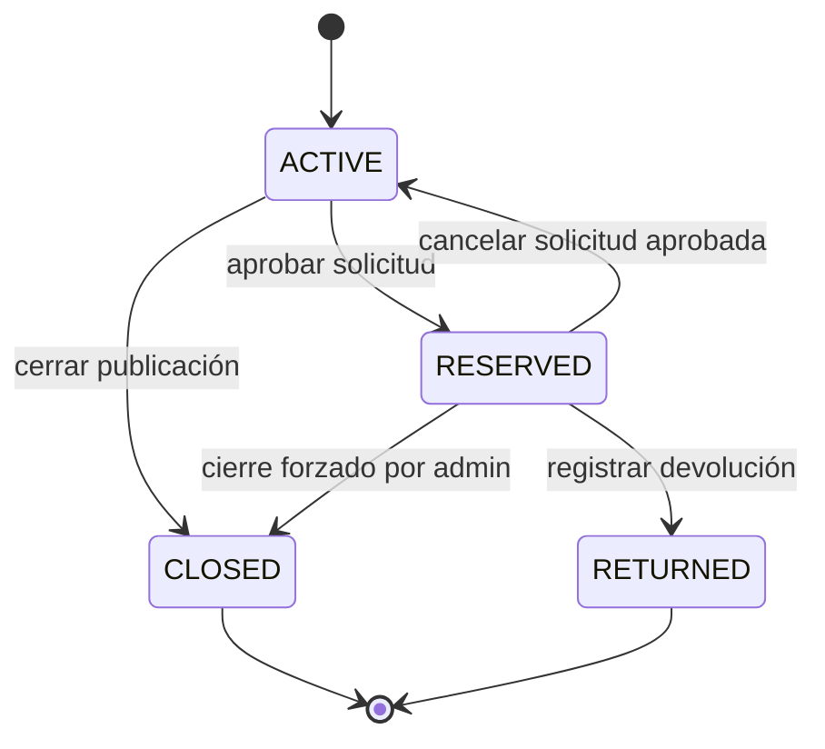
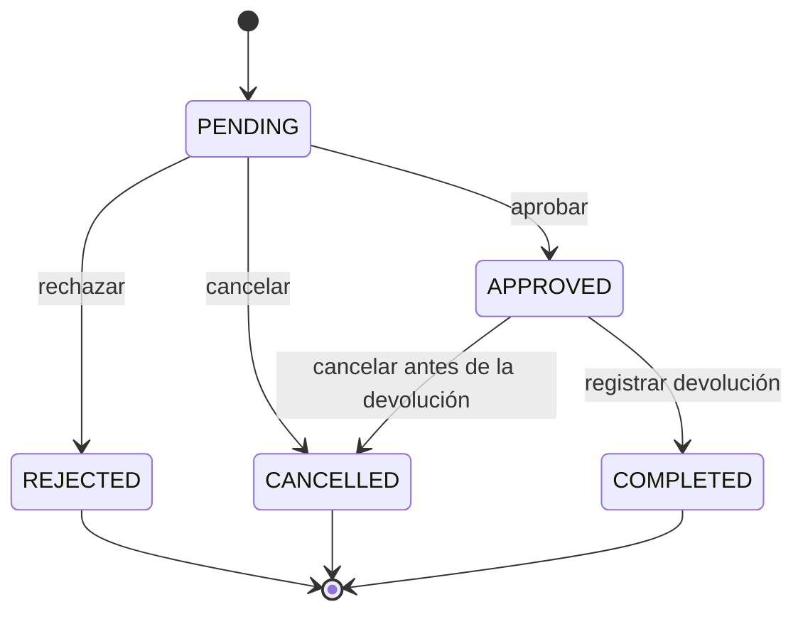
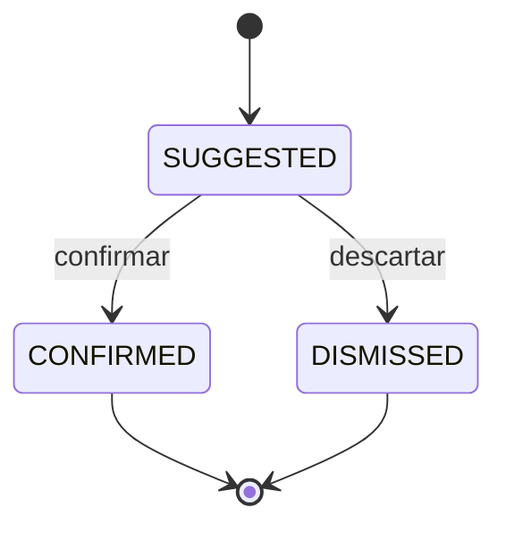

# Modelo de dominio

## 1. Actores

| Actor | Descripción |
|---|---|
| Usuario autenticado | Persona con una cuenta; puede registrar publicaciones, buscar, solicitar recuperaciones y usar el asistente. |
| Propietario de una publicación | Usuario que registró la publicación. Puede gestionarla según su estado. |
| Solicitante | Usuario que pide recuperar un objeto encontrado. No puede ser el propietario de esa publicación. |
| Administrador | Puede intervenir en la gestión de publicaciones, solicitudes y devoluciones según las reglas aprobadas. |

El usuario se identifica por el claim `sub` del JWT. Las herramientas del asistente no reciben `userId` ni `role` como parámetros.

## 2. Casos de uso

| # | Caso de uso | Componente que aplica las reglas |
|---|---|---|
| 1 | Registrar una publicación perdida | NestJS |
| 2 | Registrar una publicación encontrada | NestJS |
| 3 | Buscar publicaciones | NestJS |
| 4 | Filtrar y ordenar resultados | NestJS |
| 5 | Ver el detalle de una publicación | NestJS |
| 6 | Sugerir coincidencias | NestJS |
| 7 | Solicitar recuperación | NestJS |
| 8 | Gestionar devolución | NestJS |
| 9 | Gestionar publicaciones propias | NestJS |
| 10 | Usar el asistente | FastAPI + LangChain + MCP, delegando reglas en NestJS |

## 3. Entidades principales

### 3.1 Publicación

Representa un objeto perdido o encontrado.

| Campo | Descripción |
|---|---|
| `id` | Identificador de la publicación. |
| `type` | `LOST` o `FOUND`. |
| `status` | `ACTIVE`, `RESERVED`, `RETURNED` o `CLOSED`. |
| `owner_id` | Usuario propietario de la publicación. |
| `title` | Título breve. |
| `description` | Descripción del objeto. |
| `category` | Categoría; es una señal blanda para las coincidencias. |
| `location` | Lugar donde se perdió o encontró. |
| `event_date` | Fecha del evento. |
| `search_text` | Texto normalizado utilizado por la búsqueda y el prefiltro de coincidencias. |
| `created_at`, `updated_at` | Marcas temporales. |

### 3.2 Solicitud de recuperación

Representa el pedido de un usuario para recuperar una publicación de tipo `FOUND`.

| Campo | Descripción |
|---|---|
| `id` | Identificador de la solicitud. |
| `publication_id` | Publicación encontrada asociada. |
| `requester_id` | Usuario que solicita la recuperación. |
| `status` | `PENDING`, `APPROVED`, `REJECTED`, `CANCELLED` o `COMPLETED`. |
| `notes` | Notas del solicitante. |
| `cancelled_by_id` | Actor que canceló, si corresponde. |
| `cancellation_reason` | Motivo de la cancelación, si corresponde. |
| `created_at`, `updated_at` | Marcas temporales. |

Reglas:

- Solo se crean sobre publicaciones `FOUND`.
- El solicitante no puede ser el propietario de la publicación.
- Aprobar una solicitud pone la publicación en `RESERVED` y rechaza las demás solicitudes pendientes de esa publicación.

### 3.3 Devolución

Representa la entrega del objeto al solicitante.

| Campo | Descripción |
|---|---|
| `id` | Identificador de la devolución. |
| `publication_id` | Publicación devuelta. |
| `request_id` | Solicitud aprobada que origina la devolución. |
| `registered_by_id` | Usuario que registra la devolución. |
| `delivered_by_id` | Usuario que entrega el objeto. |
| `received_by_id` | Usuario que lo recibe. |
| `notes` | Observaciones. |
| `created_at` | Marca temporal. |

Reglas:

- La devolución es de un solo paso en la versión 1.
- La registra el propietario o un administrador.
- Un administrador puede registrar la devolución sin ser quien entrega el objeto.
- El servidor deriva los identificadores; el cliente solo aporta notas y, cuando corresponda en una versión posterior, la confirmación.
- La confirmación del solicitante queda diferida a la versión 2.

### 3.4 Coincidencia

Representa una sugerencia entre una publicación perdida y una encontrada.

| Campo | Descripción |
|---|---|
| `id` | Identificador de la coincidencia. |
| `lost_publication_id` | Publicación de tipo `LOST`. |
| `found_publication_id` | Publicación de tipo `FOUND`. |
| `status` | `SUGGESTED`, `CONFIRMED` o `DISMISSED`. |
| `score` | Puntaje calculado por NestJS. |
| `created_at`, `updated_at` | Marcas temporales. |

No existe el estado `INVALIDATED`. Una coincidencia es **accionable** si ambas publicaciones siguen en estado `ACTIVE`; esa condición se deriva y no se almacena como un estado adicional.

## 4. Máquinas de estado

### 4.1 Publicación



Reglas:

- `RESERVED -> RETURNED` solo ocurre mediante el registro de una devolución.
- El propietario no puede cerrar una publicación `RESERVED`.
- Un administrador puede forzar el cierre de una publicación `RESERVED`, pero primero debe cancelar la solicitud aprobada.
- Al cancelar una solicitud aprobada, la publicación vuelve a `ACTIVE`, salvo que el administrador esté aplicando un cierre forzado.
- La publicación `RETURNED` representa una devolución completada en la versión 1.

### 4.2 Solicitud de recuperación



Reglas:

- El solicitante, el propietario o un administrador pueden cancelar una solicitud aprobada antes de que exista una devolución.
- La cancelación registra el actor y el motivo.
- Una solicitud `COMPLETED` no se cancela.
- Una solicitud `REJECTED` no se reabre; se debe crear una nueva si corresponde.

### 4.3 Coincidencia



La condición de “accionable” se calcula en cada consulta a partir del estado de ambas publicaciones.

## 5. Algoritmo de coincidencias v1

### 5.1 Prefiltro obligatorio

Para una publicación `LOST` se buscan candidatas `FOUND` activas, y viceversa.

El prefiltro es duro:

```sql
search_text % :q
```

Con:

```sql
SET pg_trgm.similarity_threshold = 0.15;
```

La categoría **no** es un filtro duro. Solo participa en la reponderación de los candidatos que ya pasaron el prefiltro textual.

### 5.2 Orden y límite de candidatos

Los candidatos se ordenan por:

```text
text_score DESC, event_date DESC, id ASC
```

Se limita la cantidad de candidatos a un valor configurable, inicialmente **500**.

El puntaje completo se calcula en NestJS, no en la base de datos.

### 5.3 Puntaje

| Señal | Peso |
|---|---:|
| Texto | 0.50 |
| Categoría | 0.20 |
| Fecha | 0.15 |
| Ubicación | 0.15 |

- Umbral de sugerencia: **0.55**.
- Se devuelven como máximo **10** sugerencias por ejecución.
- Una sugerencia por debajo del umbral no se muestra.

### 5.4 Limitación documentada

Los candidatos que no pasan el prefiltro textual o que quedan fuera de los primeros 500 no pueden ser sugeridos. Esta limitación es parte del diseño v1 y debe tenerse presente al ajustar el umbral o el límite.

## 6. Invariantes

1. NestJS es el único componente que decide y persiste reglas de negocio.
2. FastAPI, LangChain y MCP no acceden a PostgreSQL.
3. Las herramientas MCP no aceptan `userId` ni `role` como parámetros.
4. El usuario se deriva siempre del token verificado.
5. No se comparten conversaciones, adaptadores MCP ni contexto entre usuarios.
6. Las publicaciones solo pueden llegar a `RETURNED` mediante una devolución.
7. Una solicitud `COMPLETED` implica una devolución registrada.
8. Una publicación `RESERVED` no puede ser cerrada por su propietario.
9. La aprobación de una solicitud rechaza las demás solicitudes pendientes de la misma publicación.
10. Las coincidencias descartadas no se reabren automáticamente.

## 7. Fuera de alcance de la versión 1

- Refresh tokens.
- JWKS y rotación automática de claves.
- Confirmación del solicitante en el flujo de devolución.
- Estado `INVALIDATED` para coincidencias.
- Acceso del asistente a PostgreSQL.
- Reglas de negocio implementadas en el frontend o en los servidores MCP.
